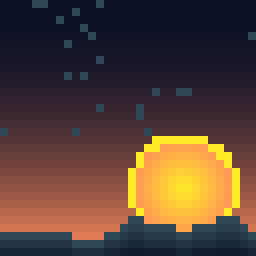

# dsh-pixel-studio

[](https://github.com/Fantety/dsh-pixel-studio/actions/workflows/ci.yml)
[](LICENSE)
[](https://github.com/deepseek-ai/deepseek-harness)

A native, in-chat **pixel art and pixel animation studio** for
[DeepSeek Harness](https://github.com/deepseek-ai/deepseek-harness). The agent
writes a procedural shader, palette-indexed grids, or a template/motion recipe,
and the result is rendered as an interactive canvas directly in the conversation
— not as a deliverable card or a separate viewer page.

The same result is also exported as real production files: transparent PNG,
GIF89a animation, spritesheet + JSON atlas, an optional standalone HTML viewer,
and an [oy-pixel](https://github.com/Fantety/oy-pixel)-compatible `.oypx`
project.





## Why another pixel tool?

- **Native canvas first.** Playback, frame stepping, zoom, pixel grid, onion
  skin, palette, and craft score live in the chat tool view.
- **Shader-like procedural generation.** `pixel_shader` is an adaptation of
  oy-pixel's `pixel_run_shader` design: a bounded Lua-subset canvas API with
  `pal`, `mix`, `hsv`, `alpha`, `rand`, `noise`, `phase`/`time`, shapes,
  flood-fill, outline and stamp. The language is not Lua itself, but the
  generation contract follows the same design.
- **Designed for agents.** One-character-per-pixel grids are compact,
  deterministic, easy to diff, and validated before any file is written.
- **Actual game assets.** PNG, GIF, spritesheet, atlas JSON, OYPX and a manifest
  are written together.
- **Craft-aware generation.** A DSH system-prompt section adapted from
  oy-pixel's pixel-art guidance is injected while the plugin is mounted, and
  every result includes a deterministic craft report.
- **Zero runtime dependencies.** Host code uses Node built-ins only; the client
  half uses the React runtime already supplied by DSH.
- **Safe by design.** Shader scripts run in a bounded tree-walking interpreter
  with no host access; inline canvas data is capped and decoded locally; the
  plugin performs no network requests.

## Features

### Native chat canvas

- Auto-play for animations, play/pause, previous/next frame
- Nearest-neighbour zoom (1–24×), pixel grid, onion skin
- Checker/dark/light background
- Palette chips, frame count, FPS and craft score
- Open PNG, GIF, spritesheet, OYPX, or optional HTML directly from the card
- Compact fallback panel when the artwork exceeds the inline budget

### Pixel tools

- `pixel_shader` — procedural generation with a Lua-subset canvas API,
  deterministic `rand`/`noise`, palette helpers, shapes, `stamp`, and
  `phase`/`time` animation sampling
- `pixel_art` — stills, icons, sprites, scenes, portraits
- `pixel_animation` — explicit frames or a base sprite plus a motion recipe
- 7 built-in palettes: PICO-8, Game Boy, Sweetie 16, DawnBringer 16/32,
  Studio Warm, Ink & Paper
- Custom palettes and single-character `legend` maps
- Layered drawing with source-over alpha
- 12 built-in 16×16 templates: slime, cat, robot, potion, sword, heart, ghost,
  star, coin, tree, mushroom, crystal
- Motion presets: `bob`, `float`, `breathe`, `sway`, `shake`, `pulse`, `spin`,
  `orbit`
- Outline, shadow, background, GIF loop count and per-frame duration
- OYPX v2 with direct `#RRGGBBAA` row RLE, current oy-pixel parser compatible

## Requirements

- DeepSeek Harness **0.2.1-rc.2 or newer within 0.2.x**
- Node.js **20 or newer** for development and tests
- A DSH Web GUI (the client half is `platform: "web"`)

## Install

The package is a DSH **bundle** as well as a plugin: host entry `lib/index.js`,
client entry `lib/client.js`, `dsh.bundle.patch` pointing at
`cordis.patch.yml`, and a `dsh.client` declaration. The bundle patch inserts
the `pixel-studio` loader row; **do not copy that row into your profile patch
manually** when installing through the Plugin Manager.

### Plugin Manager (recommended, including Desktop)

Paste either address into **Settings → Plugins → Install**:

```text
https://github.com/Fantety/dsh-pixel-studio
```

or, when SSH access to GitHub is configured:

```text
git+ssh://git@github.com/Fantety/dsh-pixel-studio.git
```

The manager installs the package, adds `dsh-pixel-studio` to the profile's
`dsh.profile.bundles`, and applies the bundled patch. No hand-edited
`cordis.patch.yml` row is needed.

### CLI-managed profile

Replace `my-profile` with its name (for example `web`, `headless`, or a custom
profile):

```bash
dsh plugin --profile my-profile add \
  "git+ssh://git@github.com/Fantety/dsh-pixel-studio.git"
```

This forwards the package operation to pnpm and reconciles the profile's bundle
list. Confirm that `dsh-pixel-studio` appears in `dsh.profile.bundles` in
`~/.dsh/profiles/my-profile/package.json`; the bundled `cordis.patch.yml` then
adds the plugin row.

The `desktop` profile is owned by the Electron app. Install it through the
Plugin Manager rather than editing that profile by hand.

Reload the profile, then **refresh the Web GUI once** so the client bundle is
loaded. If the tool card is still generic after a refresh, restart DSH.

### Local development link

```bash
cd ~/.dsh/profiles/my-profile
pnpm add "link:/absolute/path/to/dsh-pixel-studio"
```

Then add `"dsh-pixel-studio"` to `dsh.profile.bundles` in that profile's
`package.json` and reload. Do not also keep an old manual `pixel-studio`
insert row: the bundle patch now owns that row. Remove it if it exists.

## Quick start

Ask the agent in natural language:

> Draw a 32×32 moss slime with top-left lighting and make an 8-frame floating
> animation. Export it as PNG, GIF and OYPX.

Or call the tool directly:

```json
{
  "name": "moss-slime",
  "template": "slime",
  "palette": "sweetie16",
  "effects": { "outline": true, "shadow": true },
  "outputDir": "pixel-art"
}
```

Hand-drawn grid with a legend:

```json
{
  "name": "tiny-heart",
  "legend": { "O": "#3B0D1A", "R": "#EF4B6B", "L": "#FF9FB2" },
  "grid": [
    ".OO..OO.",
    "ORROORRO",
    "ORLRRRRO",
    "ORRRRRRO",
    ".ORRRRO.",
    "..ORRO..",
    "...OO...",
    "........"
  ],
  "scale": 12
}
```

Without `legend`, characters `0-9a-z` are palette indices (up to 36 colours).
`.` is always transparent. The default palette is `sweetie16`.

### Animation

```json
{
  "name": "native-ghost",
  "template": "ghost",
  "palette": "sweetie16",
  "effects": { "shadow": true, "shadowColor": "#00000055" },
  "motion": { "preset": "float", "frames": 8, "amplitude": 1 },
  "fps": 12,
  "loop": 0,
  "scale": 10
}
```

Explicit frames are also supported:

```json
{
  "name": "coin-spin",
  "palette": "dawnbringer16",
  "fps": 10,
  "loop": 0,
  "frames": [
    { "grid": ["..00..", ".0110.", "011110", "011110", ".0110.", "..00.."] },
    { "grid": ["...00.", "..0110", ".01110", ".01110", "..0110", "...00."], "durationMs": 80 },
    { "grid": ["....00", "...011", "..0111", "..0111", "...011", "....00"], "durationMs": 60 }
  ]
}
```

### Procedural shader

Use the shader path when a formula is shorter than rows: gradients, glows,
textures, symmetry, geometry and formula-driven animation.

```json
{
  "name": "shader-horizon",
  "width": 32,
  "height": 32,
  "palette": "studio",
  "seed": 12,
  "code": "local top = hex('#0B1026')\nlocal low = hex('#FF8A5C')\nfor y = 0, height - 1 do\n  local t = y / (height - 1)\n  for x = 0, width - 1 do canvas.pset(x, y, mix(top, low, t * t)) end\nend\ncanvas.circfill(width * 0.7, height * 0.72, 7, hex('#FFEC27'))\nfor x = 0, width - 1 do\n  local ridge = math.floor(height * 0.72 + noise(x, 0, 0.18) * 8)\n  for y = ridge, height - 1 do canvas.pset(x, y, hex('#2F4858')) end\nend"
}
```

The language is a safe Lua **subset**, not a Lua runtime: `local`, assignment,
calls, `if/elseif/else`, numeric `for`, `while`, `break`, table constructors,
and `[key]` indexing. Canvas API:

```text
canvas.pset(x, y, c)            canvas.pget(x, y)
canvas.line(x0, y0, x1, y1, c)  canvas.rect / rectfill
canvas.circle / circfill        canvas.ellipse / ellipsefill
canvas.flood(x, y, c)           canvas.replace(old, new)
canvas.outline(c)               canvas.clear(c)
canvas.stamp(rows, legend, x, y)
```

Globals: `width`, `height`, `time`, `phase`, `frame_index`, `frame_count`.
Helpers: `pal(i)` (1-based), `hex`, `mix`, `hsv`, `alpha`, `rand`, `noise`,
`clamp`, `step`, `smoothstep`, `math.*`, `string.format/len/lower/upper/sub/rep`.
Set `frameCount > 1` to render an animation sampled with `time`/`phase`.

The shader tool mirrors oy-pixel's design (canvas operations, palette indexing,
time/phase uniforms, seeded randomness) but runs in a bounded JS interpreter
instead of embedding Lua. No host globals, filesystem or network access is
available to shader code. See [docs/SHADER.md](docs/SHADER.md) for the full
API, design mapping and examples.

## Output files

Files are written under the session workspace, by default `pixel-art/`:

```text
pixel-art/
  moss-slime.png                 transparent 1× PNG
  moss-slime-preview.png         nearest-neighbour preview on checkerboard
  moss-slime.gif                 animated GIF (when 2+ frames)
  moss-slime-sheet.png           spritesheet
  moss-slime-sheet.json          frame x/y/width/height/duration atlas
  moss-slime.oypx                oy-pixel v2 project
  moss-slime.json                asset manifest + craft report
  moss-slime-viewer.html         optional: includeViewer: true
```

### Craft report

Every generation includes a deterministic `craft` object in the tool result and
manifest:

```json
{
  "score": 100,
  "checks": [],
  "metrics": {
    "colours": 9,
    "contrast": 61.2,
    "isolatedPixels": 0,
    "loopDelta": 19.4,
    "averageFrameMs": 83
  }
}
```

Checks cover contrast, isolated pixels, loop seams, frame timing, palette size
and silhouette coverage. Warnings are actionable; the agent is instructed to
iterate on them before finishing.

## Craft guidance

While mounted, the plugin registers a DSH system-prompt section named
`pixel-studio:craft` (order `2500`). It is adapted from oy-pixel's
`PIXEL_AGENT_INSTRUCTIONS` workflow and its `PIXEL ART CRAFT` /
`PIXEL ANIMATION CRAFT` guidance, and covers:

- compose once, verify once; prefer a small procedural shader over long grids
- silhouette first, 2×2+ detail clusters, clean stair-stepped diagonals
- one top-left light source, hue-shifted 3–5 step ramps, cast shadows
- ordered dithering, one outline strategy, sparing anti-aliasing
- lean animation counts, key poses, easing, anticipation/overshoot, squash,
  smears, subpixel motion, secondary motion and loop seams

The same guidance is referenced from all three tool descriptions.

## Architecture

```text
pixel_shader ──► Lua-subset AST ──► bounded interpreter ──┐
pixel_art / pixel_animation ──► grids / layers / motion ──┤
                                                          ▼
                                      frames + palette + craft report
                                                          │
                                      write PNG / GIF / sheet / OYPX / manifest
                                                          │
                                      compact presentationMeta.canvas
                                                          │
                                                          ▼
                                  lib/client.js → tool.call.toolview → <canvas>
```

- **Host half** (`lib/`, Node ESM) has no runtime dependencies and uses
  `node:zlib` for PNG.
- **Shader half** (`lib/pixel/shader.js` + `lib/pixel/lua/`) is a bounded
  tree-walking interpreter for a Lua subset. It exposes an oy-pixel-style
  canvas API, palette helpers, seeded `rand`/`noise`, and `time`/`phase`
  animation uniforms. No host globals, `require`, or filesystem access.
- **Client half** (`lib/client.js`) is a hand-written
  `window.__ModuleLoader__.load` factory, registered for all three tools.
- **Inline data** is palette-indexed, one or two characters per pixel, capped
  at 131,072 pixels and 4,096 colours. Shader gradients therefore stay visible
  in the native canvas instead of falling back immediately.
- **No network**: the plugin reads only the current session working directory
  and writes only under `outputDir`.

More detail: [docs/ARCHITECTURE.md](docs/ARCHITECTURE.md).

## Development

```bash
git clone git@github.com:Fantety/dsh-pixel-studio.git
cd dsh-pixel-studio
npm test
npm run check
npm run demo
npm run demo:showcase
npm run demo:shader
```

The demo scripts regenerate the checked-in examples. No install step is needed
because the plugin has zero runtime dependencies.

## Limits

- Canvas side ≤ 256 px; animation ≤ 120 frames and 8,000,000 total pixels.
- Grid-character palettes ≤ 36 colours; use `legend` for up to 64 symbols.
- Shader scripts are capped at 64 KiB, 20M instructions and 5s per frame, with
  a 10s total generation budget; `width`/`height`/`frameCount` are upper-bounded.
- GIF timing granularity is 10 ms; frames below 20 ms are stored at 20 ms.
- GIF transparency is 1-bit; translucent edges are quantised.
- OYPX export supports at most 256 unique colours.
- The plugin does not call an image generation model; the agent writes grids or
  shader code, which the plugin renders deterministically.

## Contributing

Issues and pull requests are welcome. See [CONTRIBUTING.md](CONTRIBUTING.md),
[CODE_OF_CONDUCT.md](CODE_OF_CONDUCT.md), and [SECURITY.md](SECURITY.md).

## License and attribution

This project is released under the [MIT License](LICENSE), the same license
used by DeepSeek Harness.

The craft guidance is adapted from
[oy-pixel](https://github.com/Fantety/oy-pixel), Copyright © 2026 Fantety. See
[THIRD_PARTY_NOTICES.md](THIRD_PARTY_NOTICES.md) for attribution details.

中文说明：[README.zh.md](README.zh.md)
