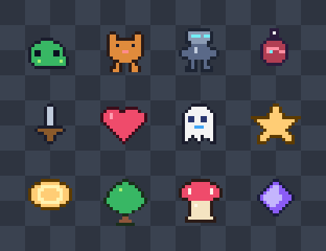

# dsh-pixel-studio

[English](README.md) | 中文

[](https://github.com/Fantety/dsh-pixel-studio/actions/workflows/ci.yml)
[](LICENSE)
[](https://github.com/deepseek-ai/deepseek-harness)

面向 [DeepSeek Harness](https://github.com/deepseek-ai/deepseek-harness) 的
**像素画 / 像素动画生成插件**。模型编写调色板索引网格，或使用模板 + 动作参数，
插件把结果显示为聊天内原生 Canvas，并同时导出可直接用于游戏开发的素材文件。




## 特性

- **聊天内原生画布**：播放/暂停、逐帧、1-24× 最近邻缩放、网格、洋葱皮、
  调色板、craft 分数；不再使用交付物卡片或独立 viewer 作为主界面。
- **两个工具**：`pixel_art` 生成静态像素画；`pixel_animation` 支持显式逐帧
  或基础精灵 + 动作预设。
- **真实素材导出**：透明 PNG、GIF89a、精灵表 + JSON atlas、OYPX v2 工程、
  manifest；独立 HTML viewer 可选。
- **绘画技巧约束**：注册 DSH 系统提示词段 `pixel-studio:craft`，把
  oy-pixel 的 `PIXEL ART CRAFT` / `PIXEL ANIMATION CRAFT` 规则注入每次生成。
- **Craft 报告**：自动检查对比度、孤立像素、循环缝、帧时长、颜色数量和
  剪影覆盖率，并写入工具结果与 manifest。
- **零运行时依赖**：Host 只用 Node 内置模块；Client 使用 DSH 自带的 React。
- **不访问网络**：只读写 Session 工作目录下的文件。

## 环境要求

- DeepSeek Harness **0.2.1-rc.2 或更高，0.2.x 范围内**
- Node.js **20+**（开发/测试）
- DSH Web GUI（Client 半侧声明为 `platform: "web"`）

## 安装

```bash
# 1) 通过 SSH 安装到 profile
dsh plugin --profile desktop add "git+ssh://git@github.com/Fantety/dsh-pixel-studio.git"

# 2) 在 profile 的 cordis.patch.yml 追加：
```

```yaml
- insert:
    - id: pixel-studio
      name: dsh-pixel-studio
```

重新加载 profile，然后**刷新一次 Web 页面**以加载 Client bundle。刷新后工具卡片
仍是通用卡片时，重启一次 DSH。

本地开发：

```bash
cd ~/.dsh/profiles/desktop
pnpm add "link:/absolute/path/to/dsh-pixel-studio"
```

## 使用

直接用自然语言：

> 画一个 32×32 的苔藓史莱姆，左上打光，做成 8 帧漂浮动画，导出 PNG、GIF 和 OYPX。

直接调用：

```json
{
  "name": "moss-slime",
  "template": "slime",
  "palette": "sweetie16",
  "effects": { "outline": true, "shadow": true },
  "outputDir": "pixel-art"
}
```

使用 `legend` 手绘：

```json
{
  "name": "tiny-heart",
  "legend": { "O": "#3B0D1A", "R": "#EF4B6B", "L": "#FF9FB2" },
  "grid": [
    ".OO..OO.",
    "ORROORRO",
    "ORLRRRRO",
    "ORRRRRRO",
    ".ORRRRO.",
    "..ORRO..",
    "...OO...",
    "........"
  ],
  "scale": 12
}
```

动画：

```json
{
  "name": "native-ghost",
  "template": "ghost",
  "palette": "sweetie16",
  "effects": { "shadow": true, "shadowColor": "#00000055" },
  "motion": { "preset": "float", "frames": 8, "amplitude": 1 },
  "fps": 12,
  "loop": 0,
  "scale": 10
}
```

## 输出

```text
pixel-art/
  moss-slime.png                 透明 PNG
  moss-slime-preview.png         最近邻棋盘格预览
  moss-slime.gif                 动画 GIF
  moss-slime-sheet.png           精灵表
  moss-slime-sheet.json          帧图集
  moss-slime.oypx                oy-pixel v2 工程
  moss-slime.json                资源清单 + craft 报告
  moss-slime-viewer.html         可选：includeViewer: true
```

内嵌 Canvas 预算：**131,072 像素 / 64 色**；超限时退回为打开文件的紧凑面板。
GIF 透明度为 1-bit，时间粒度为 10 ms。OYPX 最多 256 色。

## 开发与测试

```bash
git clone git@github.com:Fantety/dsh-pixel-studio.git
cd dsh-pixel-studio
npm test
npm run check
npm run demo
npm run demo:showcase
```

代码结构：

```text
lib/
  index.js            Host 入口
  plugin.js           DSH 工具注册、参数校验、内嵌画布
  craft-prompt.js     绘画技巧系统提示词段
  client.js           Client 工具视图
  pixel/              渲染、编码、导出、craft 检查
scripts/              示例生成脚本
test/                 Node 测试
examples/             生成结果示例
docs/                 架构说明
```

## 许可证与致谢

本项目使用 [MIT License](LICENSE)，与 DeepSeek Harness 的许可证一致。

绘画技巧文本改编自 [oy-pixel](https://github.com/Fantety/oy-pixel)
（Copyright © 2026 Fantety）。详见
[THIRD_PARTY_NOTICES.md](THIRD_PARTY_NOTICES.md)。
